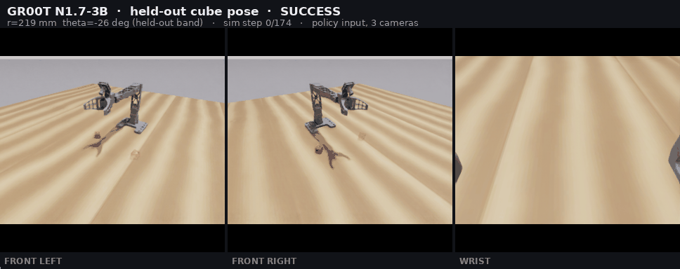
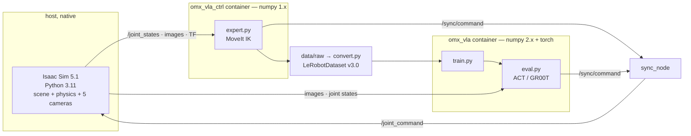

# OMX-VLA — vision-only grasping in Isaac Sim: ACT vs. GR00T N1.7

Teaching a 5-DOF OpenManipulator-X to pick up a cube in NVIDIA Isaac Sim **from camera images alone** —
the policy never receives the cube's coordinates — then fine-tuning NVIDIA's `GR00T-N1.7-3B` on the
same data to see whether a 3-billion-parameter VLA beats a small task-specific baseline.

It did not.



<sub>A held-out rollout, exactly as the policy sees it. Three of the five recorded cameras; the black
bands are the letterbox padding from [the aspect-ratio fix](#3-aspect-ratio-a-handicap-gr00t-had-and-act-did-not).</sub>

---

## Headline result

Every policy trained on the same 486 episodes / 100,096 frames, evaluated on **cube poses that appear
zero times in the training data**.

| Policy | Params | Best checkpoint | Held-out success | 95% CI |
|---|---|---|---|---|
| **ACT** | 52 M | step 5 000 | **92 %** (55/60) | [85 %, 99 %] |
| GR00T N1.7 v1 — frozen vision | 3.14 B (1.62 B trainable) | step 40 000 | 60 % (36/60) | [48 %, 72 %] |
| GR00T N1.7 v2 — tuned vision | 3.14 B (2.03 B trainable) | step 6 000 | 58 % (35/60) | [46 %, 71 %] |
| GR00T N1.7 v3 — tuned vision, lr 1e-5 | 3.14 B (2.03 B trainable) | step 14 000 | 35 % (21/60) | [23 %, 47 %] |

```
ACT vs v1    z = 4.05    significant        52 M beats 3.14 B by 1.5x
v1  vs v2    z = 0.19    no difference      tune_visual changes nothing
v2  vs v3    z = 2.56    significant        lr 1e-5 is worse, not better
```

**The likely explanation is the task, not the hyperparameters.** One object, one instruction repeated
across all 486 episodes — the language dimension is a constant, and `modeling_act.py` contains no
language processing at all. A VLA has nothing to contribute to a task that carries no language.
Testing that properly is [the unfinished half of this project](#status).

Full analysis, per-checkpoint scans and raw numbers: **[docs/RESULTS.md](docs/RESULTS.md)**.

---

## Why the evaluation is the interesting part

Three bugs shaped this project. None of them raised an error.

### 1. The evaluator fed five cameras to three-camera checkpoints

The client subscribed to all five recorded cameras; the models were trained on three. GR00T's
processor picks image keys with `sorted(available)` when `video_modality_keys is None`, so the third
view silently changed identity:

```
trained on    front_left, front_right, wrist                            V=3
evaluated on  front_left, front_right, rear_left, rear_right, wrist     V=5
```

No crash — just quietly worse numbers. It inverted a conclusion: GR00T v2 measured **12 %**, and that
number supported a confident, mechanistic write-up about catastrophic forgetting in the unfrozen
vision tower. Re-measured correctly, v2 scores **58 %**. The forgetting never happened. ACT was immune
(`modeling_act.py` takes only the cameras its config declares), which is part of why the gap looked
even larger than it was.

### 2. Reproducible is not the same as correct

The bad v1 number was measured twice, independently, landing on 43 % and 42 %. That agreement was
written down as evidence the number was trustworthy. Both runs used the same broken evaluator — the
consistency only proved the bug was deterministic.

The bug was then "ruled out" by spot-checking 20 episodes of the *least* affected model. 8/20 has a
95 % CI of [21 %, 61 %]; it could not distinguish 43 % from the 60 % measured later. A standard of 60
episodes had already been set, and then not used for the check that mattered.

### 3. Aspect ratio: a handicap GR00T had and ACT did not

Found by watching rollout video: GR00T's motion structure was entirely correct — turn, descend to the
right height, close at the right moment, lift — but it was imprecise about *where*. GR00T's
preprocessing stretches 320×240 straight to 256×256, so a 25 mm cube (8×8 px at this camera geometry)
becomes 33 % taller than wide, and a rotated square shears into a parallelogram by an amount that
varies with yaw. ACT consumes the native frame and never sees this. Fixed with letterbox padding in
`convert.py --pad-square`.

### What got overturned

[docs/RESULTS.md](docs/RESULTS.md) keeps a running table of claims this project made and later had to
withdraw, because they were all the same mistake — closing an investigation on insufficient evidence:

| Claim | Why it was wrong |
|---|---|
| Unfreezing vision caused catastrophic forgetting (12 %) | Measurement artifact. Actually 58 %, indistinguishable from v1 |
| The five-camera bug does not affect existing numbers | Checked 20 episodes of the least-affected model |
| GR00T plateaus at 43–45 % | Both figures were low; actually 58–60 % |
| v3 systematically fails on the right half of the workspace | One checkpoint leaned left; single-checkpoint pattern over-generalized |
| GR00T learns patchwork region-memory rather than a general mapping | Kappa was only ever measured on v3, the worst configuration |

---

## How it works



**A scripted expert generates the data; the policy never sees what the expert saw.** The expert solves
IK against the cube's ground-truth pose — that privilege exists only at data-generation time. The
policy receives images and joint states, nothing else. Standard privileged-expert → visuomotor-student.

Design choices worth knowing, each with a reason that cost something to learn:

- **Everything speaks ROS 2.** The expert, the keyboard jog tool and the trained policy all publish the
  same `/sync/command`. Deploying a policy was a five-line change rather than a milestone.
- **Two containers, because MoveIt and LeRobot cannot share a Python environment.** LeRobot needs
  numpy ≥ 2.0; `moveit_py` is a C++ binding and numpy 2.0 broke the C ABI. It *imports cleanly and
  segfaults at run time with no message*. The boundary is drawn with two images rather than trusting
  anyone to remember a `PYTHONPATH`.
- **Raw dump first, dataset second.** `recorder.py` writes format-agnostic PNG + npz; `convert.py`
  builds the LeRobotDataset. LeRobot went v2 → v2.1 → v3.0 within a year, and the scene changed twice.
  Changing the dataset's shape is a re-convert, not a re-record.
- **Record five cameras, choose at training time.** Four environment cameras on a symmetric ring plus
  a wrist camera. `--cameras` selects the subset; no script hard-codes a camera name.
- **Control loop runs on simulation time, not wall clock.** Isaac does not rate-limit under headless
  streaming (measured 2.42×, drifting with GPU load). `time.sleep(1/30)` let 80 ms of sim time pass per
  tick, the seed trajectory moved, and position-only IK drifted out of its solvable range: **11/20 vs
  19/20**.

More, including the physics parameters and the USD facts that cost the most time:
**[docs/DESIGN.md](docs/DESIGN.md)**.

---

## Evaluation protocol

Worth stating explicitly, because it is what the headline number rests on.

- **Success** = cube lifted 0.05 m, still within 0.06 m of the gripper, held for 15 consecutive control
  cycles (0.5 s at 30 Hz). The distance test rejects cubes that were knocked away; the hold test
  rejects momentary bounces. In the multi-object task, success additionally requires lifting the
  *instructed* object, and "lifted the wrong one" is reported separately from "timed out".
- **Held-out poses.** The cube spawns at θ ∈ [−50°, +50°]. Two bands, **[−35°, −20°] and [+20°, +35°]**,
  contain **0 of the 486 training episodes** (verified by counting). The bands sit *inside* the range
  rather than at the edges: a policy replaying an average trajectory while ignoring the image collapses
  in the middle, whereas the outer edge is also simply the hardest reach, which would confound "poor
  generalization" with "difficult".
- **Evaluation is not deterministic.** The same checkpoint, seed and cube pose gives different results
  between runs — Isaac's physics and rendering shift frame arrival with GPU load (ACT step 5000 scored
  both 10/10 and 9/10). Every checkpoint therefore gets **3 rounds × 20 episodes, a new seed per
  round**.

---

## Repository layout

```
isaac/        build_scene.py, texture.py     scene + procedural textures, run by Isaac's interpreter
src/          ROS 2 packages                 expert, recorder, IK (analytic + MoveIt), spawn sampler
ml/           convert · train · eval · audit dataset, training, held-out evaluation
task/         *.task.yaml                    scene, randomization, success criteria — no magic numbers in code
docker/       compose + reference images     the two-container split
docs/         RESULTS · DESIGN · SETUP       English; zh/ holds the original engineering record
```

Two task specs are kept: `pick_cube.task.yaml` (three objects, language-conditioned) and
`pick_cube_1obj.task.yaml`, frozen so the four models above remain reproducible.

---

## Status

**Complete and measured — the single-object task.** Scene, scripted expert (20/20 under both IK
solvers), 486-episode dataset, ACT and three GR00T fine-tunes, all evaluated on held-out poses with
confidence intervals. That is the result table above.

**Built but not finished — the language-conditioned task.** The point of the comparison above is that
a VLA has no advantage when the instruction is a constant. The follow-up puts three named objects on
the table (dice, Rubik's cube, gift box) with the instruction selecting one, where ACT is
*structurally* capped at ~33 % because it has no language pathway at all. What exists:

- ✅ 1 868 episodes / 384 147 frames recorded and converted, balanced across the three instructions,
  0 episodes in the held-out bands, `ml/audit.py` passing
- ✅ Evaluation upgraded to score "picked the *right* object" and to separate wrong-object from timeout
- ⚠️ GR00T training **stopped at step 12 000 of 24 000** (~0.75 epoch); the only rollouts run against it
  are a 5-episode plumbing smoke test against a step-3 000 checkpoint, which is not a score
- ❌ The ACT control group was never trained, so the comparison does not yet exist
- ❌ `groot_3obj_lr4` — the "letterbox + lr 1e-4" cell that [docs/RESULTS.md](docs/RESULTS.md) argues is
  the one worth running — is configured but never run

**Out of scope throughout: the physical arm.** Everything is closed-loop in simulation. The policy
drives `/sync/command`, which is the same topic that moves the real follower, but the expert pins
`targets:=sim` and the real arm is never commanded. Sim-to-real would need a wrist camera on real
hardware and gripper limits the URDF does not currently provide (±360°, which stops nothing).

---

## Running it

⚠️ **This repository is not self-contained, by design.** The arm's USD, URDF, meshes, joint profile and
the sync engine all live in a separate Docker image so that there is exactly one source of truth for
them — reproducing those files here is how you get a scene that looks right and whose numbers are
wrong. Those images currently sit in a private registry, so **cloning this repo alone will not give you
a running system**.

What it does give you: every piece of task-side code, the complete dataset and evaluation pipeline, and
a precise contract for what the base image has to provide — plus reference copies of both Dockerfiles
in [`docker/images/`](docker/images/). See **[docs/SETUP.md](docs/SETUP.md)** for the contract, the
hardware the numbers were measured on, and the end-to-end command sequence.

---

## Documentation

| | |
|---|---|
| [docs/RESULTS.md](docs/RESULTS.md) | Held-out evaluation, per-checkpoint scans, the three bugs, every withdrawn claim |
| [docs/DESIGN.md](docs/DESIGN.md) | Architecture, kinematics, physics parameters, dataset format, invariants |
| [docs/SETUP.md](docs/SETUP.md) | Dependencies, the image contract, how to run each stage |
| [docs/zh/](docs/zh/) | The original Chinese decision log and results record |

Environment the numbers were measured on: Isaac Sim 5.1.0-rc.19 · LeRobot 0.6.1 · torch 2.11.0+cu128 ·
NVIDIA RTX PRO 6000 Blackwell (96 GB).

## License

[Apache-2.0](LICENSE). The OpenManipulator-X model and MoveIt configuration are ROBOTIS';
`GR00T-N1.7-3B` is NVIDIA's and carries its own license.
